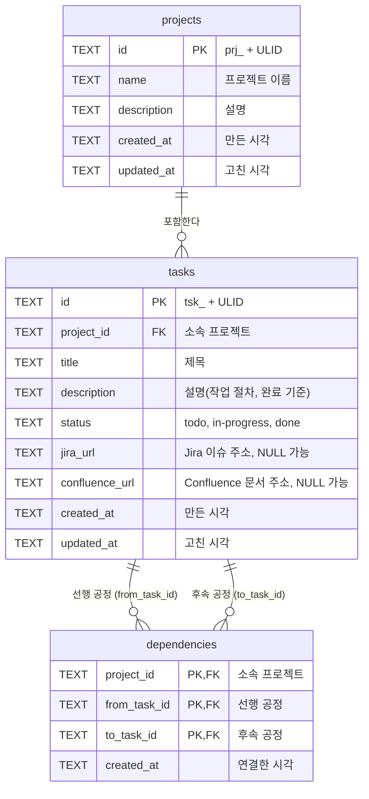

# Tevro — 테이블 설계서(ERD)

- 문서 상태: MVP 코드 기준 설명서. 스키마의 원본은 코드(`src/server/store.ts`의 `SCHEMA`)이며, 스키마를 바꾸면 이 문서도 함께 고친다.
- 작성 기준일: 2026-10-25
- 대상 DB: SQLite 3.53(`better-sqlite3`에 포함), 파일 하나(`data/tevro.db`, 위치는 `TEVRO_DATA_DIR`로 바꿈)
- 관련 문서: [ADR-0003 저장소와 동시 수정 모델](./adr/0003-storage-and-concurrency.md), [ADR-0005 식별자 체계와 삭제 정책](./adr/0005-identifiers-and-deletion.md), [제품 요구사항 §7](./product-requirements.md)

## 1. ERD

`dependencies` 한 행이 연결 하나다. `from_task_id → to_task_id`는 from 공정이 to 공정의 선행 공정이라는 뜻이다.

## 2. 테이블 목록

| 테이블 | 담는 것 | 관계 |
| --- | --- | --- |
| `projects` | 프로젝트 | 공정을 0개 이상 가진다 |
| `tasks` | 공정(할 일) | 한 프로젝트에 속하고, 연결의 선행·후속이 된다 |
| `dependencies` | 선후관계(연결) | 같은 프로젝트의 공정 둘을 잇는다 |

## 3. 관계

| 관계 | 카디널리티 | 연결 키 | 부모를 지우면 |
| --- | --- | --- | --- |
| projects → tasks | 1 : 0..N | `tasks.project_id` → `projects.id` | 공정도 지워진다(CASCADE). MVP에는 프로젝트 삭제 기능이 없다 |
| tasks → dependencies(선행) | 1 : 0..N | `(project_id, from_task_id)` → `tasks(project_id, id)` | 그 공정의 연결이 지워진다(CASCADE) |
| tasks → dependencies(후속) | 1 : 0..N | `(project_id, to_task_id)` → `tasks(project_id, id)` | 그 공정의 연결이 지워진다(CASCADE) |

`dependencies`에는 `projects`로 가는 외래 키가 따로 없다. 두 복합 외래 키가 같은 `project_id`를 쓰므로 선행·후속 공정이 모두 그 프로젝트에 속해야만 저장된다. 다른 프로젝트의 공정끼리는 DB 수준에서도 이을 수 없다.

## 4. 테이블 정의

NULL 열의 `N`은 NOT NULL이다. 길이 제한과 형식 검사는 서버가 한다(SQLite는 TEXT 길이를 제한하지 않는다).

### 4.1 projects — 프로젝트

| 컬럼 | 타입 | NULL | 기본값 | 키 | 설명 |
| --- | --- | --- | --- | --- | --- |
| `id` | TEXT | N | | PK | `prj_` + ULID 26자(소문자). 예: `prj_01m5rz3a4a288bbvgc0rbsvc51` |
| `name` | TEXT | N | | | 프로젝트 이름. 앞뒤 공백을 지우고 1~100자 |
| `description` | TEXT | N | `''` | | 설명, 최대 10,000자. MVP 화면에는 입력란이 없고 API로만 넣는다 |
| `created_at` | TEXT | N | | | 만든 시각. ISO 8601 UTC 문자열(예: `2026-10-25T07:14:17.026Z`) |
| `updated_at` | TEXT | N | | | 고친 시각. MVP에는 프로젝트 수정 기능이 없어 만든 시각과 같다 |

### 4.2 tasks — 공정

| 컬럼 | 타입 | NULL | 기본값 | 키 | 설명 |
| --- | --- | --- | --- | --- | --- |
| `id` | TEXT | N | | PK | `tsk_` + ULID 26자(소문자). 제목을 바꿔도 그대로다 |
| `project_id` | TEXT | N | | FK | 소속 프로젝트. `projects.id` 참조, ON DELETE CASCADE |
| `title` | TEXT | N | | | 제목. 앞뒤 공백을 지우고 1~200자 |
| `description` | TEXT | N | `''` | | 설명(작업 절차, 완료 기준 등). 최대 10,000자 |
| `status` | TEXT | N | `'todo'` | CHECK | 실행 상태. `todo`(미착수), `in-progress`(진행 중), `done`(완료) |
| `jira_url` | TEXT | Y | NULL | | Jira 이슈 주소. http·https만, 최대 2,000자. 링크만 저장하며 Jira 상태는 가져오지 않는다 |
| `confluence_url` | TEXT | Y | NULL | | Confluence 문서 주소. http·https만, 최대 2,000자 |
| `created_at` | TEXT | N | | | 만든 시각(ISO 8601 UTC) |
| `updated_at` | TEXT | N | | | 고친 시각. 제목·설명·상태·링크를 바꿀 때 갱신 |

제약과 인덱스:

- `UNIQUE (project_id, id)`: `dependencies`의 복합 외래 키가 가리키는 키다. `id`만으로도 유일하지만, 프로젝트까지 묶어야 "같은 프로젝트의 공정"인지 DB가 확인할 수 있다.
- `CHECK (status IN ('todo', 'in-progress', 'done'))`: 세 값 밖의 상태를 막는다.
- `INDEX tasks_by_project (project_id)`: 프로젝트의 공정 목록 조회용.

### 4.3 dependencies — 선후관계

| 컬럼 | 타입 | NULL | 기본값 | 키 | 설명 |
| --- | --- | --- | --- | --- | --- |
| `project_id` | TEXT | N | | PK, FK | 소속 프로젝트. 아래 두 외래 키에 함께 쓰인다 |
| `from_task_id` | TEXT | N | | PK, FK | 선행 공정. `(project_id, from_task_id)` → `tasks(project_id, id)`, ON DELETE CASCADE |
| `to_task_id` | TEXT | N | | PK, FK | 후속 공정. `(project_id, to_task_id)` → `tasks(project_id, id)`, ON DELETE CASCADE |
| `created_at` | TEXT | N | | | 연결한 시각(ISO 8601 UTC) |

제약:

- `PRIMARY KEY (project_id, from_task_id, to_task_id)`: 같은 연결을 두 번 넣지 못한다.
- `CHECK (from_task_id <> to_task_id)`: 공정을 자기 자신과 잇지 못한다.

연결 목록은 연결한 순서(rowid)로 돌려준다.

## 5. 무결성: DB 제약과 서버 검증

순환은 여러 행에 걸친 조건이라 DB 제약으로 표현할 수 없다. 서버는 모든 쓰기를 `BEGIN IMMEDIATE` 트랜잭션으로 열고, 그 안에서 현재 연결을 읽어 검사한 뒤 저장한다. 그래서 A → B와 B → A가 동시에 들어와도 하나만 저장된다(ADR-0003, AC-18).

| 규칙 | DB 제약 | 서버 검증 | 거부할 때 오류 코드 |
| --- | --- | --- | --- |
| 같은 연결 중복 금지 | PK | 저장 전 검사 | `VALIDATION_DUPLICATE_EDGE` |
| 자기 자신 연결 금지 | CHECK | 저장 전 검사 | `VALIDATION_SELF_LOOP` |
| 없는 공정과 연결 금지 | 외래 키 | 저장 전 검사 | `REFERENCE_NOT_FOUND` |
| 다른 프로젝트 공정과 연결 금지 | 복합 외래 키 | 저장 전 검사 | `CROSS_PROJECT_REFERENCE` |
| 순환 금지 | 없음(표현할 수 없음) | 트랜잭션 안에서 검사 | `VALIDATION_CYCLE`(순환 경로 포함) |
| 실행 상태 값 | CHECK | 저장 전 검사 | `VALIDATION_INPUT` |
| 길이 제한, 링크 형식(http·https) | 없음 | 저장 전 검사 | `VALIDATION_INPUT` |
| 공정을 지울 때 연결 정리 | 외래 키 CASCADE | — | — |

DB 제약은 서버 검증이 놓친 경우를 막는 두 번째 방어선이다. 사용자에게 보이는 오류 문구는 서버 검증에서 나온다.

## 6. 저장하지 않고 계산하는 값

API 응답에는 있지만 테이블에는 없는 값이다. 저장하면 상태나 연결이 바뀔 때마다 함께 고쳐야 하고 어긋날 수 있어서, 조회할 때 계산한다(PRD §7.2).

| API 필드 | 계산 방법 |
| --- | --- |
| `jiraKey` | `jira_url`에서 `ABC-123` 꼴의 이슈 키를 꺼낸다. 없으면 null |
| `predecessorIds`, `successorIds` | `dependencies`에서 찾은 직접 선행·후속 공정 |
| `unmetPrerequisiteIds` | 직접 선행 공정 중 `status`가 `done`이 아닌 공정 |
| `prerequisitesMet` | `unmetPrerequisiteIds`가 비어 있는지 |
| `summary` | 프로젝트 공정의 상태별 개수 |

## 7. 저장소 설정과 운영

- 연결할 때마다 `journal_mode = WAL`, `foreign_keys = ON`, `busy_timeout = 5000`을 설정한다. SQLite는 외래 키 검사가 기본으로 꺼져 있다.
- 시각과 ID는 TEXT로 저장한다. SQLite에는 날짜 타입이 없다.
- 테이블은 서버가 시작할 때 `CREATE TABLE IF NOT EXISTS`로 만든다. 마이그레이션 도구는 아직 없다(8장의 주의 참고).
- 백업 기능은 아직 없다. 서버를 멈춘 뒤 `data` 폴더를 통째로 복사하면 된다.

## 8. ADR에 있지만 MVP에서 미룬 것

| 항목 | 근거 | 추가될 것 |
| --- | --- | --- |
| 공정 계층 | ADR-0003 1.7 | `tasks.parent_id`(NULL 허용, `(project_id, parent_id)` → `tasks(project_id, id)` 외래 키, 자기 자신 금지 CHECK) |
| 구조 리비전 | ADR-0003 1.1 | `projects.graph_revision` INTEGER |
| 공정 버전(낙관적 잠금) | ADR-0003 1.2 | `tasks.version` INTEGER |
| 사용자·인증 | ADR-0004 | 사용자, 인증 수단, 세션, 개인 액세스 토큰 테이블과 생성·수정 행위자 컬럼 |
| 노드 좌표 | README의 ADR 후보 '그래프 배치·좌표 저장' | 구조 리비전·버전과 분리한 별도 테이블 |
| Jira 매핑 | PRD §6.7(Jira 선택 연동 단계) | 매핑·반영 결과 테이블. MVP의 `jira_url`은 링크일 뿐 매핑이 아니다 |

주의: 지금은 테이블이 없을 때만 만들기 때문에, 위 컬럼을 코드에 더해도 이미 만들어진 `data/tevro.db`에는 반영되지 않는다. 첫 컬럼을 더할 때 스키마 버전(`PRAGMA user_version`)과 버전 순서대로 적용하는 마이그레이션 단계를 함께 만든다. 시험 데이터뿐이라면 파일을 지우고 다시 만들어도 된다.
